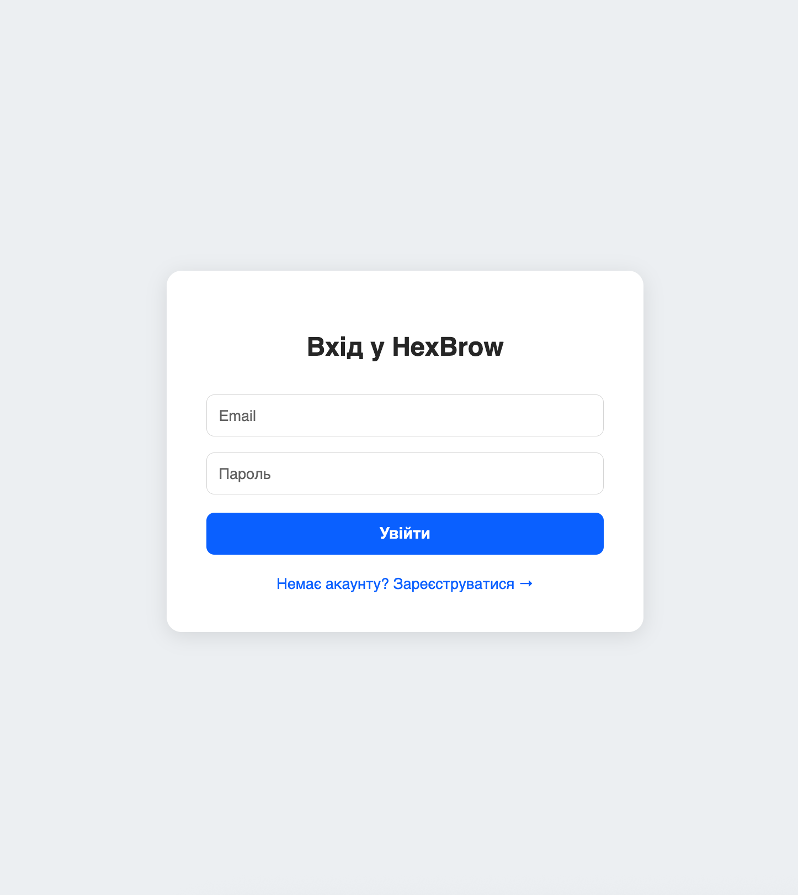
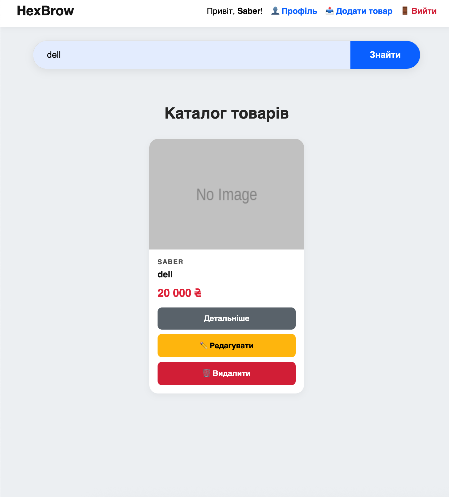
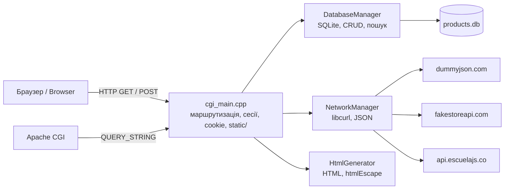
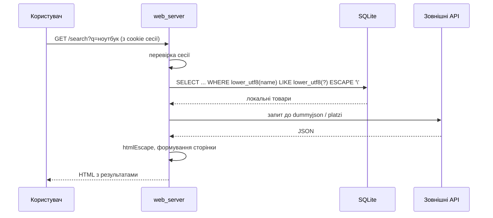

<div align="center">


# HexBrow

**Web-орієнтована пошукова система товарів на C++ / Web-oriented product search engine in C++**

[](https://isocpp.org/)
[](https://www.sqlite.org/)
[](#вимоги)
[](#тестування)
[](#тестування)
[](#автор-і-ліцензія)

**Мова / Language:** [Українська](#українська) · [English](#english)

</div>

---

<a id="українська"></a>

# 🇺🇦 Українська

## Зміст

1. [Про проєкт](#про-проєкт)
2. [Демонстрація](#демонстрація)
3. [Можливості](#можливості)
4. [Швидкий старт](#швидкий-старт)
5. [Архітектура](#архітектура)
6. [Структура проєкту](#структура-проєкту)
7. [Вимоги](#вимоги)
8. [Цілі Makefile](#цілі-makefile)
9. [Запуск](#запуск)
10. [База даних і міграції](#база-даних-і-міграції)
11. [Безпека](#безпека)
12. [Зовнішні API](#зовнішні-api)
13. [Тестування](#тестування)
14. [Відомі обмеження](#відомі-обмеження)
15. [Відхилення від методичних рекомендацій](#відхилення-від-методичних-рекомендацій)
16. [Додавання зображень до README](#додавання-зображень-до-readme)
17. [Автор і ліцензія](#автор-і-ліцензія)
18. [Оновлення: Linux, Windows, Android](#оновлення-linux-windows-android)

---

## Про проєкт

HexBrow — курсова робота з дисципліни «Програмування» (спеціальність F7 «Комп'ютерна інженерія», НТУ «Дніпровська політехніка», варіант 5: *Web-орієнтована пошукова система*).

Програма шукає товари в локальній базі SQLite і в трьох відкритих API та повертає динамічну HTML-сторінку. Бекенд написано на C++17 без зовнішніх фреймворків. HTTP-запити виконує libcurl, JSON розбирає nlohmann/json.

Є два режими роботи з одним кодом:

- **CGI-режим.** Основна вимога варіанту 5. Apache запускає `web_server` як CGI-скрипт.
- **Вбудований сервер.** `web_server --serve <порт>` слухає сокет на `127.0.0.1`. Це доповнення, яке не потребує Apache.

Окремо є нативний застосунок для macOS (`HexBrow.app`) з іконкою, який працює на тому самому сервері.

## Демонстрація

> Знімки екрана зберігаються в `docs/`. Інструкція з додавання зображень — в [кінці розділу](#додавання-зображень-до-readme).

<table>
  <tr>
    <td align="center" width="50%">
      <br>
      <sub><b>Вхід</b> — сесія в cookie HttpOnly</sub>
    </td>
    <td align="center" width="50%">
      <br>
      <sub><b>Пошук у локальній базі</b></sub>
    </td>
  </tr>
  <tr>
    <td align="center" width="50%">
      <br>
      <sub><b>Пошук у зовнішніх API</b></sub>
    </td>
    <td align="center" width="50%">
      <br>
      <sub><b>Каталог товарів (CRUD)</b></sub>
    </td>
  </tr>
  <tr>
    <td align="center" width="50%">
      <br>
      <sub><b>Профіль користувача</b></sub>
    </td>
    <td align="center" width="50%">
      <br>
      <sub><b>Нативний застосунок для macOS</b></sub>
    </td>
  </tr>
</table>

## Можливості

**Пошук**
- Пошук у локальній базі й у зовнішніх API на одній сторінці результатів.
- Регістр не має значення, включно з кирилицею: `НОУТБУК` знаходить `ноутбук`.
- Символи `%` і `_` у запиті шукаються буквально.
- Порядок параметрів в URL не важливий: `/search?x=1&q=dell` працює.

**Товари**
- Створення, перегляд, редагування, видалення товарів (CRUD).
- Фото товару завантажується як base64.

**Облікові записи**
- Реєстрація, вхід, вихід. Сесія зберігається в cookie `HttpOnly` з `SameSite=Strict`.
- Вихід видаляє сесію на сервері, старий cookie більше не працює.
- Профіль: нікнейм, аватар, опис.

**Дані**
- Старі бази оновлюються через `ALTER TABLE`. Колонки додаються, дані зберігаються.
- Шлях до бази й каталогу `static/` визначається від розташування `web_server`, а не від поточної директорії.

## Швидкий старт

```bash
make web      # збирає сервер і лаунчер, запускає сервер і відкриває браузер
make mac      # (macOS) збирає HexBrow.app з іконкою і запускає його
make stop     # зупиняє сервер
make info     # показує, чи працює сервер
```

Після `make web` відкриється `http://127.0.0.1:8080/login`.

## Архітектура



Послідовність пошуку / Search sequence:



Модулі `DatabaseManager`, `NetworkManager` і `HtmlGenerator` не залежать від інтерфейсу. Їх використовують і CGI, і вбудований сервер.

## Структура проєкту

```text
HexBrow/
├── src/
│   ├── cgi_main.cpp            # Точка входу: CGI і вбудований сервер (--serve)
│   ├── DatabaseManager.h/.cpp  # SQLite: CRUD, пошук, облікові записи, міграції
│   ├── NetworkManager.h/.cpp   # Запити до зовнішніх API і розбір JSON
│   ├── HtmlGenerator.h/.cpp    # Генерація HTML, екранування
│   ├── Product.h, User.h       # Структури даних
│   ├── Favicon.h               # Генерується tools/make_favicon_header.py
│   ├── json.hpp                # nlohmann/json (сторонній, MIT)
│   └── resurces/index.html     # Форма пошуку для режиму Apache
├── main.cpp                    # Лаунчер HexBrowWeb: запускає сервер і браузер
├── browser.mm                  # Нативний GUI для macOS (Cocoa + WebKit)
├── macos/Info.plist            # Шаблон Info.plist для .app
├── icons/                      # HexBrow.icns (macOS), HexBrow.ico (Windows), PNG
├── tools/make_favicon_header.py
├── docs/
│   ├── images/                 # Іконка для README
│   └── screenshots/            # Знімки екрана для README
├── Makefile
├── .gitignore
└── README.md
```

Під час роботи створюються (в git не зберігаються): `products.db`, `static/`, `web_server`, `HexBrowWeb`, `HexBrowApp`, `HexBrow.app/`.

## Вимоги

- Компілятор C++17: `clang++` або `g++`. На Linux: `make web CXX=g++`.
- Бібліотеки SQLite3 і libcurl. На macOS входять до SDK.
- Для `make mac`: macOS 10.15+ і Xcode Command Line Tools.
- Для CGI-режиму: Apache з `mod_cgi`.
- Windows: `Makefile` написано для Unix-середовища. Збірка на Windows не перевірялася.

## Цілі Makefile

| Ціль | Що робить |
| --- | --- |
| `make web` | Збирає `web_server` і `HexBrowWeb`, запускає сервер і відкриває браузер |
| `make mac` | Збирає `HexBrow.app` (GUI, сервер, іконка) і відкриває його |
| `make bundle` | Лише збирає `.app`, не запускаючи |
| `make restart` | Перезапускає сервер без відкриття браузера |
| `make stop` | Зупиняє `web_server` |
| `make info` | Показує, чи працює сервер, і список команд |
| `make db-clean` | Видаляє `products.db` (усі дані) |
| `make favicon` | Перегенеровує `src/Favicon.h` |
| `make clean` | Видаляє зібрані файли і `HexBrow.app` |

## Запуск

### Варіант 1. `make web` (рекомендовано)

```bash
make web
```

Лаунчер зупиняє старий сервер, запускає новий на порту 8080 і відкриває браузер. Сервер слухає лише `127.0.0.1`.

### Варіант 2. Нативний застосунок для macOS

```bash
make run
```

Збирається `HexBrow.app` з іконкою. Застосунок запускає `web_server` зі свого бандлу. Якщо `.app` переміщено, а `web_server` не знайдено, з'явиться повідомлення про помилку.

### Варіант 3. Apache (CGI)

1. Увімкніть `mod_cgi` і налаштуйте каталог:

   ```apache
   <Directory "/path/to/htdocs/cgi-bin">
       Options +ExecCGI
       AddHandler cgi-script .cgi
       Require all granted
   </Directory>
   ```

2. Скопіюйте `web_server` у `cgi-bin/search.cgi` і виконайте `chmod +x`.
3. Скопіюйте `src/resurces/index.html` у `htdocs` і відкривайте сторінку з кореня сервера.
4. `products.db` створюється поруч із `web_server`. Веб-сервер має мати право запису в цей каталог.

## База даних і міграції

- Таблиці `products` і `users` створюються, якщо їх немає.
- Для старих баз виконується міграція: відсутні колонки додаються через `ALTER TABLE`. Таблиці не видаляються, дані зберігаються.
- Email має унікальний індекс `idx_users_email`. Старі записи без email його не порушують.
- Розташування бази: поруч із `web_server`. Для `make web` це корінь репозиторію, для `make mac` — `HexBrow.app/Contents/MacOS/`.

Щоб почати з порожньої бази, виконайте `make db-clean`.

## Безпека

**Реалізовано:**
- Параметризовані SQL-запити (захист від SQL-ін'єкцій).
- `htmlEscape` для тексту, атрибутів і `<title>`. Рядки в JavaScript екрануються через `escapeJs`.
- Захист від path traversal для `/static/`: перевірка канонічного шляху за компонентами, а не за рядковим префіксом. Симлінки назовні блокуються.
- Токен сесії: 32 hex-символи з `/dev/urandom` (на Windows — `rand_s`). Cookie `HttpOnly` і `SameSite=Strict`.
- `SIGPIPE` ігнорується на Unix, тому закриття з'єднання клієнтом не зупиняє сервер.
- `LIKE` з `ESCAPE '\'`: `%` і `_` не працюють як wildcard.

**Обмеження (навчальний проєкт):**
- Паролі хешуються через `std::hash`. Це не криптографічний хеш, і його результат залежить від стандартної бібліотеки. Для реальної роботи потрібні bcrypt, scrypt або Argon2.
- Сесії зберігаються в пам'яті без терміну дії.
- Немає CSRF-токенів.
- Немає обмеження частоти запитів до `/login`.
- Немає HTTPS.

## Зовнішні API

| Джерело | Що повертає | Коли використовується |
| --- | --- | --- |
| [dummyjson.com](https://dummyjson.com) | до 100 товарів, пошук за запитом | завжди, коли є запит |
| [fakestoreapi.com](https://fakestoreapi.com) | 20 товарів | лише при порожньому запиті |
| [api.escuelajs.co](https://api.escuelajs.co) (Platzi) | до 100 товарів, пошук за назвою | завжди, коли є запит |

Ціни з dummyjson і fakestoreapi в USD і переводяться в гривні за курсом 41.5. Курс фіксований і орієнтовний.

## Тестування

Сервер зібрано на Linux з `g++ -std=c++17 -Wall -Wextra` без попереджень.

| Перевірка | Очікуваний результат | Статус |
| --- | --- | --- |
| `GET /static/../../file` | 403 | ✅ |
| `GET /static/../products.db` | 403 | ✅ |
| Симлінк з `static/` назовні | 403 | ✅ |
| Пошук `ноутбук`, `НОУТБУК`, `ЇЖАК` | знаходить незалежно від регістру | ✅ |
| `%` і `_` у запиті | літерали, не wildcard | ✅ |
| `<script>` у запиті і в назві товару | екрановано | ✅ |
| Токени сесій при трьох входах | різні, 32 hex-символи | ✅ |
| Вихід і повторне використання cookie | перенаправлення на `/login` | ✅ |
| Міграція старої бази без `email` | дані збережено, колонки додано | ✅ |
| Запуск з іншої директорії | база і `static/` поруч з `web_server` | ✅ |
| Розрив з'єднання під час великої відповіді | сервер працює далі | ✅ |
| Сторінка входу відкривається в браузері | `/login` показує форму | ✅ (знімок) |
| `make web_server` без попереджень | так | ✅ |
| Збірка й запуск `browser.mm` на macOS | — | ⏳ перевірити на Mac |
| `make web` на macOS | — | ⏳ перевірити на Mac |
| Збірка на Windows | — | ⏳ не перевірялося |

**Як відтворити тести.** Запустіть `make web`, потім виконайте запити з таблиці. Наприклад:

```bash
curl -s --path-as-is -o /dev/null -w "%{http_code}\n" "http://127.0.0.1:8080/static/../products.db"   # очікуємо 403
```

## Відомі обмеження

- **Паролі** — `std::hash` (див. [Безпека](#безпека)).
- **Сесії** не мають терміну дії, поки працює сервер.
- **Немає CSRF-токенів.** Частково захищає `SameSite=Strict`.
- **Немає rate limiting** на `/login`.
- **Вбудований сервер однопотоковий.**
- **Ім'я користувача унікальне**, успадковано зі старої схеми.
- **Старі користувачі без email** не можуть увійти, потрібна повторна реєстрація.
- **GUI** збирається тільки на macOS і не перевірений на Windows.
- **Курс валюти** фіксований.

## Відхилення від методичних рекомендацій

Погоджено з викладачем за умови, що відхилення описані в звіті та у файлах проєкту, а базовий функціонал виконано.

| Методичка | Реалізація | Причина |
| --- | --- | --- |
| Apache як веб-сервер (рекомендація) | Вбудований сервер `--serve`, CGI збережено | Apache потребує окремого налаштування на кожній ОС |
| Пошук лише в базі даних | Пошук у базі і в зовнішніх API | Розширення функціоналу, пошук у базі збережено |
| Консольна програма або GUI на MFC/FLTK | Веб-інтерфейс і нативний застосунок для macOS | Варіант 5 вимагає веб-інтерфейс, GUI — доповнення |

## Автор і ліцензія

**Автори:** Ілля Лебідь (GitHub: [SaberWQ](https://github.com/SaberWQ)), студент 2 курсу, спеціальність «Комп'ютерна інженерія», НТУ «Дніпровська політехніка». Ян Кравченко (GitHub: [k4rp1q-ui](https://github.com/k4rp1q-ui)), студент 2 курсу, спеціальність «Комп'ютерна інженерія», НТУ «Дніпровська політехніка»

**Керівник:** доцент кафедри інформаційних технологій та комп'ютерної інженерії, к.т.н. І. М. Гаркуша.

**Ліцензія:** навчальний проєкт, ліцензія не вказана.

---

## Оновлення: Linux, Windows, Android

> Цей розділ доповнює документацію новими платформами і змінами в коді. Попередні розділи залишено без змін. Якщо вони розходяться з цим розділом (наприклад, цілі `make mac` і `make restart` у розділі «Цілі Makefile»), актуальна інформація тут.

### Підтримувані платформи

| Платформа | Сервер | Вікно застосунку | Як запустити |
| --- | --- | --- | --- |
| macOS | `web_server` (clang++) | `HexBrow.app` (Cocoa + WebKit, `browser.mm`) | `make run` або `make web` |
| Linux | `web_server` (g++) | `HexBrowLinux` (GTK3 + WebKitGTK 4.1, `gui/browser_linux.cpp`) | `make init`, потім `make run` або `make web` |
| Windows | `web_server.exe` (MSYS2 MINGW64, g++) | вихідний код `gui/browser_win.cpp` (WebView2), Makefile його не збирає | `build.bat` або `make web` |
| Android | запускається на комп'ютері | `app/` — клієнт на WebView | [Android-клієнт](#android-клієнт) |

### Єдиний Makefile

Один `Makefile` сам визначає ОС (macOS, Linux, Windows у MSYS2) і вибирає компілятор, бібліотеки та файли GUI. Прапорці компіляції: `-std=c++17 -I src -Wall -Wextra`.

| Ціль | Що робить |
| --- | --- |
| `make init` | Встановлює залежності: перевіряє Xcode CLT (macOS), ставить пакети через `apt`, `dnf` або `pacman` (Linux), перевіряє `g++` (Windows) |
| `make build` | Збирає сервер і GUI. На macOS створює ще й `HexBrow.app`, на Windows збирає лише сервер |
| `make build-server` | Лише `web_server` (`web_server.exe` на Windows) |
| `make build-gui` | Лише GUI: `HexBrowApp` (macOS) або `HexBrowLinux` (Linux). На Windows виводить підказку |
| `make bundle` | macOS: збирає `HexBrow.app` з `macos/Info.plist`, бінарними файлами та іконкою, підписує ad-hoc через `codesign` |
| `make run` | Зупиняє старий сервер і відкриває нативне вікно (macOS: `open HexBrow.app`, Linux: `./HexBrowLinux`) |
| `make web` | Збирає сервер і лаунчер, запускає сервер і відкриває браузер. Працює на всіх платформах |
| `make stop` | Зупиняє `web_server` (`killall` на macOS і Linux, `taskkill` на Windows) |
| `make clean`, `make db-clean`, `make favicon`, `make info` (`make help`) | Працюють як раніше |

Цілей `make mac` і `make restart` у новому `Makefile` немає. Замість `make mac` використовуйте `make run` (або `make build`, якщо потрібно лише зібрати). Замість `make restart` виконайте `make stop`, потім `make web` або `make run`.

Файли, які збирає `make`:

| Платформа | Виходи |
| --- | --- |
| macOS | `web_server`, `HexBrowApp`, `HexBrowWeb`, `HexBrow.app` |
| Linux | `web_server`, `HexBrowLinux`, `HexBrowWeb` |
| Windows | `web_server.exe`, `HexBrowWeb.exe` |

### Скрипти збірки

- **`build.sh`** збирає `web_server` і `HexBrowWeb` через `clang++` і одразу запускає лаунчер. Потрібні `clang++`, SQLite3 і libcurl. GUI скрипт не збирає.
- **`build.bat`** для Windows перевіряє наявність `g++`, збирає `web_server.exe` (з `-lws2_32`) і `HexBrowWeb.exe`, потім запускає `HexBrowWeb.exe`. Потрібне середовище MSYS2 MINGW64:

  ```bash
  pacman -S --needed make mingw-w64-x86_64-gcc mingw-w64-x86_64-sqlite3 mingw-w64-x86_64-curl
  ```

У корені репозиторію лежать зібрані `web_server.exe` і `HexBrowWeb.exe`.

### Лаунчер `HexBrowWeb` (`main.cpp`)

Лаунчер зупиняє старий `web_server`, запускає `web_server --serve 8080` у фоні й відкриває `http://127.0.0.1:8080` у браузері за замовчуванням (`open` на macOS, `xdg-open` на Linux, `start` на Windows). На macOS і Windows він спочатку переходить у каталог свого виконуваного файлу. На Linux цього переходу немає, тому запускайте його з каталогу, де лежить `web_server`.

### Windows

1. Встановіть [MSYS2](https://www.msys2.org) і відкрийте термінал MINGW64.
2. Встановіть пакети командою з розділу «Скрипти збірки».
3. У корені проєкту виконайте `make web` або запустіть `build.bat`.
4. Відкриється `http://127.0.0.1:8080`.

Нативне вікно для Windows (`gui/browser_win.cpp`, Win32 + WebView2) потребує Visual Studio 2022, Windows 10/11 SDK і WebView2 SDK (NuGet `Microsoft.Web.WebView2`). `Makefile` і `build.bat` його не збирають. Код запускає `web_server.exe` без вікна консолі й завершує його при закритті вікна.

Зміни в `src/cgi_main.cpp` для Windows:
- `#pragma comment(lib, "ws2_32.lib")` працює лише в MSVC, тому для MinGW бібліотека підключається прапорцем `-lws2_32`.
- Результат `accept()` на Windows порівнюється з `INVALID_SOCKET`.

### Linux

```bash
make init     # apt, dnf або pacman: gcc, pkg-config, GTK3, WebKitGTK 4.1, SQLite3, libcurl
make run      # збирає сервер і GUI, відкриває нативне вікно
```

`gui/browser_linux.cpp` запускає `./web_server --serve 8080` через `fork()`, відкриває вікно 1200×800 з WebKitGTK і показує `http://127.0.0.1:8080`. При закритті вікна серверу надсилається `SIGTERM`. Шлях `./web_server` відносний, тому запускайте GUI з кореня проєкту (`make run` так і робить).

### Параметри сервера

```bash
./web_server --serve 8080                    # порт (за замовчуванням 8080)
./web_server --serve 8080 --bind 0.0.0.0     # слухати всі IPv4-інтерфейси
```

- `--bind` за замовчуванням дорівнює `127.0.0.1`: сервер доступний лише з цього комп'ютера.
- Без аргументів (і без змінної `REQUEST_METHOD`) сервер тепер запускається на `127.0.0.1:8080`. Раніше програма виводила підказку з використанням.
- CGI-режим не змінився.
- **Увага.** `--bind 0.0.0.0` відкриває сервер усій мережі, а HTTPS немає, паролі хешуються через `std::hash`. Використовуйте це лише для тестів у довіреній домашній мережі й зупиняйте сервер після роботи.

### Помилки бази даних

Якщо базу `products.db` не вдається відкрити або ініціалізувати, сервер відповідає сторінкою `500 Database Error` з текстом помилки та шляхом до бази й продовжує працювати.


Як користуватися:

1. Підключіть комп'ютер і телефон до однієї мережі Wi-Fi.
2. На комп'ютері запустіть `./web_server --serve 8080 --bind 0.0.0.0`.
3. Дізнайтеся IP комп'ютера (macOS: `ipconfig getifaddr en0`, Linux: `hostname -I`, Windows: `ipconfig`).
4. У `app/src/main/java/com/hexbrow/MainActivity.java` змініть `DEFAULT_URL` (зараз `http://192.168.1.10:8080`) або введіть адресу в полі зверху й натисніть «→».
5. Відкрийте проєкт у Android Studio і запустіть застосунок.

В емуляторі Android комп'ютер доступний за адресою `http://10.0.2.2:8080`, тому `--bind 0.0.0.0` для нього не потрібен.

Примітки:
- Файл `build.properties` (з пробілом наприкінці назви) містить shell-команду, яка створює `gradle.properties` з трьома рядками: `android.useAndroidX=true`, `android.nonTransitiveRClass=true`, `org.gradle.jvmargs=-Xmx2048m -Dfile.encoding=UTF-8`. Gradle читає лише файл `gradle.properties`, тому створіть його з цим вмістом.
- Gradle wrapper (`gradlew`) у репозиторії немає, тож збирайте проєкт з Android Studio.
- `app/src/main/res/xml/network_security_config.xml` не підключено в `AndroidManifest.xml`.
- У `src/NetworkManager.cpp` є заготовка `#ifdef ANDROID`, яка вимикає пошук в інтернеті, і в `cgi_main.cpp` є коментар про `globalExeDir` з Android JNI. Це підготовка до можливої нативної збірки. Налаштування NDK і CMake в проєкті немає, а з `-DANDROID` файл `NetworkManager.cpp` зараз не збирається. Через WebView-клієнт пошук в інтернеті працює як у браузері, бо його виконує сервер на комп'ютері.

### Нові та змінені файли

```text
HexBrow/
├── app/                           # Android-клієнт (WebView)
│   ├── build.gradle
│   └── src/main/
│       ├── AndroidManifest.xml
│       ├── java/com/hexbrow/MainActivity.java
│       └── res/xml/network_security_config.xml
├── gui/
│   ├── browser_linux.cpp          # GTK3 + WebKitGTK 4.1
│   └── browser_win.cpp            # Win32 + WebView2 (не збирається Makefile)
├── build.sh                       # збірка і запуск (macOS/Linux, clang++)
├── build.bat                      # збірка і запуск (Windows, MSYS2 MINGW64)
├── build.gradle, settings.gradle  # Gradle-проєкт Android
├── build.properties               # має стати gradle.properties (див. примітки)
├── web_server.exe, HexBrowWeb.exe # зібрані для Windows
└── .gitignore                     # додано .gradle/ і .idea/
```

Змінено: `Makefile` (універсальний, див. вище), `main.cpp` (лаунчер для трьох ОС), `src/cgi_main.cpp` (`--bind`, обробка помилок бази, виправлення для Windows), `src/NetworkManager.cpp` (заготовка для Android), `browser.mm` (сервер запускається з робочою директорією `Contents/MacOS`, тому `products.db` створюється поруч із ним, а не в корені диска).

### Тестування нових можливостей

Таблиця в розділі «Тестування» описує стан коду на момент коміту README. Зміни з цього розділу варто перевірити окремо:

| Перевірка | Статус |
| --- | --- |
| `make build` і `make run` на Linux (GTK3 + WebKitGTK) | ⏳ не перевірялося |
| `build.bat` і `make web` на Windows (MSYS2) | ⏳ зібрані `.exe` є в репозиторії, повний прогін тестів не виконано |
| Android-клієнт у Android Studio | ⏳ не перевірялося |
| Доступ з телефона при `--bind 0.0.0.0` | ⏳ не перевірялося |

### Відомі обмеження (доповнення)

- **Витік пам'яті й з'єднань.** Для кожного запиту сервер створює `DatabaseManager` через `new` (змінна `db_ptr` у `src/cgi_main.cpp`) і не видаляє його. Деструктор, який закриває з'єднання SQLite, не викликається, тому при довгій роботі накопичуються пам'ять і відкриті дескриптори. Виправлення: `std::unique_ptr<DatabaseManager>`.
- **Сторінка помилки бази** показує шлях до `products.db`. Для локального навчального проєкту це припустимо.
- **Вікно для Windows** не збирається через `Makefile`, а `make web` відкриває звичайний браузер.
- **Android-клієнт** працює лише разом із запущеним сервером на комп'ютері. Для фізичного пристрою сервер потрібно запускати з `--bind 0.0.0.0`.
- **Нативна збірка під Android** (NDK) не налаштована.

---

<div align="right"><a href="#hexbrow">↑ угору / back to top</a></div>

<br>

<a id="english"></a>

# 🇬🇧 English

## Contents

1. [About](#about)
2. [Screenshots](#screenshots)
3. [Features](#features)
4. [Quick start](#quick-start)
5. [Architecture](#architecture)
6. [Project layout](#project-layout)
7. [Requirements](#requirements)
8. [Make targets](#make-targets)
9. [Running](#running)
10. [Database and migrations](#database-and-migrations)
11. [Security](#security)
12. [External APIs](#external-apis)
13. [Testing](#testing)
14. [Known limitations](#known-limitations)
15. [Deviations from the course guidelines](#deviations-from-the-course-guidelines)
16. [Adding images to this README](#adding-images-to-this-readme)
17. [Author and license](#author-and-license)
18. [Update: Linux, Windows, Android](#update-linux-windows-android)

---

## About

HexBrow is a coursework project for the "Programming" course (specialty F7 Computer Engineering, National Technical University "Dnipro Polytechnic", variant 5: *Web-oriented product search engine*).

The program searches products in a local SQLite database and in three public APIs, and returns a dynamically generated HTML page. The backend is C++17 without external frameworks. HTTP requests use libcurl; JSON is parsed with nlohmann/json.

Two modes share the same code:

- **CGI mode.** The main requirement of variant 5. Apache runs `web_server` as a CGI script.
- **Built-in server.** `web_server --serve <port>` listens on `127.0.0.1`. This is an addition that does not require Apache.

There is also a native macOS app (`HexBrow.app`) with an icon, which uses the same server.

## Features

**Search**
- Search in the local database and external APIs on one results page.
- Case-insensitive, including Cyrillic: `НОУТБУК` finds `ноутбук`.
- `%` and `_` in the query are matched literally.
- Parameter order in the URL does not matter: `/search?x=1&q=dell` works.

**Products**
- Create, read, update and delete products (CRUD).
- Product photos uploaded as base64.

**Accounts**
- Registration, login, logout. The session is stored in an `HttpOnly` cookie with `SameSite=Strict`.
- Logout deletes the session on the server, so the old cookie stops working.
- Profile: nickname, avatar, description.

**Data**
- Old databases are upgraded with `ALTER TABLE`. Columns are added, data is kept.
- The database and `static/` are located relative to `web_server`, not the current directory.

## Quick start

```bash
make web      # builds the server and launcher, starts the server, opens the browser
make mac      # (macOS) builds HexBrow.app with icon and runs it
make stop     # stops the server
make info     # shows whether the server is running
```

After `make web`, open `http://127.0.0.1:8080/login`.

## Architecture

See the diagrams in the Ukrainian section above (Mermaid). They are the same for both languages.

## Project layout

See [Структура проєкту](#структура-проєкту). File names are the same.

## Requirements

- A C++17 compiler: `clang++` or `g++`. On Linux: `make web CXX=g++`.
- SQLite3 and libcurl. Both are included in the macOS SDK.
- For `make mac`: macOS 10.15+ and Xcode Command Line Tools.
- For CGI mode: Apache with `mod_cgi`.
- Windows: the `Makefile` targets a Unix-like environment. A Windows build has not been verified.

## Make targets

| Target | Purpose |
| --- | --- |
| `make web` | Builds `web_server` and `HexBrowWeb`, starts the server and opens the browser |
| `make mac` | Builds `HexBrow.app` (GUI, server, icon) and opens it |
| `make bundle` | Builds the `.app` without launching it |
| `make restart` | Restarts the server without opening the browser |
| `make stop` | Stops `web_server` |
| `make info` | Shows whether the server is running and lists commands |
| `make db-clean` | Deletes `products.db` (all data) |
| `make favicon` | Regenerates `src/Favicon.h` |
| `make clean` | Removes build output and `HexBrow.app` |

## Running

### Option 1. `make web` (recommended)

```bash
make web
```

The launcher stops the old server, starts a new one on port 8080, and opens the browser. The server listens on `127.0.0.1` only.

### Option 2. Native macOS app

```bash
make run
```

Builds `HexBrow.app` with an icon. The app starts `web_server` from its own bundle. If the `.app` has been moved and `web_server` is not found, an error dialog appears.

### Option 3. Apache (CGI)

1. Enable `mod_cgi` and configure the directory:

   ```apache
   <Directory "/path/to/htdocs/cgi-bin">
       Options +ExecCGI
       AddHandler cgi-script .cgi
       Require all granted
   </Directory>
   ```

2. Copy `web_server` to `cgi-bin/search.cgi` and run `chmod +x`.
3. Copy `src/resurces/index.html` to `htdocs` and open the page from the server root.
4. `products.db` is created next to `web_server`. The web server user must be able to write there.

## Database and migrations

- The `products` and `users` tables are created if they do not exist.
- Old databases are migrated: missing columns are added with `ALTER TABLE`. Tables are never dropped, data is kept.
- Email has a unique index `idx_users_email`. Old rows without email do not violate it.
- Location: next to `web_server`. For `make web` that is the repository root; for `make mac` it is `HexBrow.app/Contents/MacOS/`.

To start with an empty database, run `make db-clean`.

## Security

**Implemented:**
- Parameterized SQL queries (no SQL injection).
- `htmlEscape` for text, attributes and `<title>`. Strings embedded in JavaScript are escaped with `escapeJs`.
- Path traversal protection for `/static/`: the canonical path is checked by path components, not by string prefix. Symlinks pointing outside are rejected.
- Session token: 32 hex characters from `/dev/urandom` (`rand_s` on Windows). Cookie is `HttpOnly` and `SameSite=Strict`.
- `SIGPIPE` is ignored on Unix, so a client closing a connection does not stop the server.
- `LIKE` with `ESCAPE '\'`: `%` and `_` do not act as wildcards.

**Limitations (educational project):**
- Passwords are hashed with `std::hash`. It is not cryptographic, and its output depends on the standard library. Real use requires bcrypt, scrypt or Argon2.
- Sessions live in memory and have no expiry.
- No CSRF tokens.
- No rate limiting on `/login`.
- No HTTPS.

## External APIs

| Source | Returns | When used |
| --- | --- | --- |
| [dummyjson.com](https://dummyjson.com) | up to 100 products, search by query | whenever there is a query |
| [fakestoreapi.com](https://fakestoreapi.com) | 20 products | only for an empty query |
| [api.escuelajs.co](https://api.escuelajs.co) (Platzi) | up to 100 products, search by title | whenever there is a query |

Prices from dummyjson and fakestoreapi are in USD and converted to UAH at 41.5. The rate is fixed and approximate.

## Testing

The server was built on Linux with `g++ -std=c++17 -Wall -Wextra` with no warnings.

| Check | Expected | Status |
| --- | --- | --- |
| `GET /static/../../file` | 403 | ✅ |
| `GET /static/../products.db` | 403 | ✅ |
| Symlink from `static/` to outside | 403 | ✅ |
| Search `ноутбук`, `НОУТБУК`, `ЇЖАК` | found regardless of case | ✅ |
| `%` and `_` in the query | literal characters | ✅ |
| `<script>` in query and product name | escaped | ✅ |
| Session tokens after three logins | different, 32 hex characters | ✅ |
| Logout and reuse of the cookie | redirect to `/login` | ✅ |
| Migration of an old database without `email` | data kept, columns added | ✅ |
| Start from another directory | database and `static/` next to `web_server` | ✅ |
| Client disconnect during a large response | server keeps running | ✅ |
| Login page loads in a browser | form is shown | ✅ (screenshot) |
| `browser.mm` build and run on macOS | — | ⏳ to verify on Mac |
| `make web` on macOS | — | ⏳ to verify on Mac |
| Windows build | — | ⏳ not verified |

## Known limitations

- **Passwords:** `std::hash` (see [Security](#security)).
- **Sessions** have no expiry while the server runs.
- **No CSRF tokens.** Partly mitigated by `SameSite=Strict`.
- **No rate limiting** on `/login`.
- **The built-in server is single-threaded.**
- **Usernames are unique**, inherited from the old schema.
- **Old users without email** cannot log in and must register again.
- **The GUI** builds only on macOS and has not been verified on Windows.
- **The exchange rate** is fixed.

## Deviations from the course guidelines

Agreed with the supervisor, provided the deviations are described in the report and in the project files, and the basic functionality is delivered.

| Guideline | Implementation | Reason |
| --- | --- | --- |
| Apache as the web server (recommended) | Built-in `--serve` server; CGI mode kept | Apache requires separate setup on each OS |
| Search only in the database | Search in the database and external APIs | Extended functionality; database search kept |
| Console program or MFC/FLTK GUI | Web interface and a native macOS app | Variant 5 requires a web interface; GUI is an addition |

## Author and license

**Author:** Illia Lebid (GitHub: [SaberWQ](https://github.com/SaberWQ)), second-year student, specialty F7 Computer Engineering, National Technical University "Dnipro Polytechnic". Yan Kravchenko (GitHub: [k4rp1q-ui](https://github.com/k4rp1q-ui)), second-year student, specialty F7 Computer Engineering, National Technical University "Dnipro Polytechnic"

**Supervisor:** Associate Professor, Department of Information Technologies and Computer Engineering, I. M. Harkusha, PhD.

**License:** academic project, no license specified.

---

## Update: Linux, Windows, Android

> This section extends the documentation with the new platforms and code changes. The earlier sections are left unchanged. Where they disagree with this section (for example, the `make mac` and `make restart` targets in "Make targets"), this section is current.

### Supported platforms

| Platform | Server | App window | How to run |
| --- | --- | --- | --- |
| macOS | `web_server` (clang++) | `HexBrow.app` (Cocoa + WebKit, `browser.mm`) | `make run` or `make web` |
| Linux | `web_server` (g++) | `HexBrowLinux` (GTK3 + WebKitGTK 4.1, `gui/browser_linux.cpp`) | `make init`, then `make run` or `make web` |
| Windows | `web_server.exe` (MSYS2 MINGW64, g++) | source in `gui/browser_win.cpp` (WebView2), not built by the Makefile | `build.bat` or `make web` |
| Android | runs on a computer | `app/` — WebView client | [Android client](#android-client) |

### Unified Makefile

A single `Makefile` detects the OS (macOS, Linux, Windows under MSYS2) and selects the compiler, libraries and GUI sources. Compile flags: `-std=c++17 -I src -Wall -Wextra`.

| Target | Purpose |
| --- | --- |
| `make init` | Installs dependencies: checks Xcode CLT (macOS), installs packages with `apt`, `dnf` or `pacman` (Linux), checks `g++` (Windows) |
| `make build` | Builds the server and the GUI. On macOS it also creates `HexBrow.app`; on Windows it builds the server only |
| `make build-server` | Only `web_server` (`web_server.exe` on Windows) |
| `make build-gui` | Only the GUI: `HexBrowApp` (macOS) or `HexBrowLinux` (Linux). On Windows it prints a hint |
| `make bundle` | macOS: builds `HexBrow.app` from `macos/Info.plist`, the binaries and the icon, and signs it ad hoc with `codesign` |
| `make run` | Stops the old server and opens the native window (macOS: `open HexBrow.app`, Linux: `./HexBrowLinux`) |
| `make web` | Builds the server and the launcher, starts the server and opens the browser. Works on all platforms |
| `make stop` | Stops `web_server` (`killall` on macOS and Linux, `taskkill` on Windows) |
| `make clean`, `make db-clean`, `make favicon`, `make info` (`make help`) | Work as before |

The new `Makefile` has no `make mac` or `make restart` targets. Use `make run` instead of `make mac` (or `make build` to only build). Instead of `make restart`, run `make stop` and then `make web` or `make run`.

Files produced by `make`:

| Platform | Outputs |
| --- | --- |
| macOS | `web_server`, `HexBrowApp`, `HexBrowWeb`, `HexBrow.app` |
| Linux | `web_server`, `HexBrowLinux`, `HexBrowWeb` |
| Windows | `web_server.exe`, `HexBrowWeb.exe` |

### Build scripts

- **`build.sh`** builds `web_server` and `HexBrowWeb` with `clang++` and starts the launcher right away. It needs `clang++`, SQLite3 and libcurl. It does not build the GUI.
- **`build.bat`** (Windows) checks for `g++`, builds `web_server.exe` (with `-lws2_32`) and `HexBrowWeb.exe`, then starts `HexBrowWeb.exe`. It needs the MSYS2 MINGW64 environment:

  ```bash
  pacman -S --needed make mingw-w64-x86_64-gcc mingw-w64-x86_64-sqlite3 mingw-w64-x86_64-curl
  ```

Prebuilt `web_server.exe` and `HexBrowWeb.exe` are in the repository root.

### The `HexBrowWeb` launcher (`main.cpp`)

The launcher stops the old `web_server`, starts `web_server --serve 8080` in the background and opens `http://127.0.0.1:8080` in the default browser (`open` on macOS, `xdg-open` on Linux, `start` on Windows). On macOS and Windows it first changes into the directory of its own executable. On Linux it does not, so run it from the directory that contains `web_server`.

### Windows

1. Install [MSYS2](https://www.msys2.org) and open the MINGW64 terminal.
2. Install the packages with the command from "Build scripts".
3. In the project root run `make web` or start `build.bat`.
4. `http://127.0.0.1:8080` opens.

The native Windows window (`gui/browser_win.cpp`, Win32 + WebView2) needs Visual Studio 2022, the Windows 10/11 SDK and the WebView2 SDK (NuGet `Microsoft.Web.WebView2`). Neither the `Makefile` nor `build.bat` builds it. The code starts `web_server.exe` without a console window and terminates it when the window closes.

Changes in `src/cgi_main.cpp` for Windows:
- `#pragma comment(lib, "ws2_32.lib")` only works in MSVC, so for MinGW the library is linked with `-lws2_32`.
- The result of `accept()` on Windows is compared with `INVALID_SOCKET`.

### Linux

```bash
make init     # apt, dnf or pacman: gcc, pkg-config, GTK3, WebKitGTK 4.1, SQLite3, libcurl
make run      # builds the server and the GUI, opens the native window
```

`gui/browser_linux.cpp` starts `./web_server --serve 8080` with `fork()`, opens a 1200×800 WebKitGTK window and loads `http://127.0.0.1:8080`. When the window closes, the server receives `SIGTERM`. The `./web_server` path is relative, so start the GUI from the project root (`make run` does this).

### Server options

```bash
./web_server --serve 8080                    # port (default 8080)
./web_server --serve 8080 --bind 0.0.0.0     # listen on all IPv4 interfaces
```

- `--bind` defaults to `127.0.0.1`: the server is reachable only from this computer.
- With no arguments (and no `REQUEST_METHOD` variable) the server now starts on `127.0.0.1:8080`. Before, the program printed a usage message.
- CGI mode is unchanged.
- **Warning.** `--bind 0.0.0.0` exposes the server to the whole network. There is no HTTPS, and passwords are hashed with `std::hash`. Use it only for tests on a trusted home network and stop the server afterwards.

### Database errors

If `products.db` cannot be opened or initialized, the server responds with a `500 Database Error` page that shows the error text and the database path, and keeps running.

### Android client

The `app/` directory holds a minimal WebView client with an address bar. The app **does not start a server**: it opens the page served by `web_server` running on a computer.

| Setting | Value |
| --- | --- |
| Package | `com.hexbrow` |
| `minSdk` / `targetSdk` / `compileSdk` | 24 / 34 / 34 |
| Dependency | `androidx.appcompat:appcompat:1.6.1` |
| Android Gradle Plugin | 8.2.0 |
| Permissions | `INTERNET`; HTTP allowed via `usesCleartextTraffic="true"` |

How to use it:

1. Connect the computer and the phone to the same Wi-Fi network.
2. On the computer run `./web_server --serve 8080 --bind 0.0.0.0`.
3. Find the computer's IP (macOS: `ipconfig getifaddr en0`, Linux: `hostname -I`, Windows: `ipconfig`).
4. In `app/src/main/java/com/hexbrow/MainActivity.java` change `DEFAULT_URL` (currently `http://192.168.1.10:8080`), or type the address into the field at the top and press "→".
5. Open the project in Android Studio and run the app.

In the Android emulator the computer is reachable at `http://10.0.2.2:8080`, so `--bind 0.0.0.0` is not needed there.

Notes:
- The file `build.properties` (its name ends with a space) contains a shell command that creates `gradle.properties` with three lines: `android.useAndroidX=true`, `android.nonTransitiveRClass=true`, `org.gradle.jvmargs=-Xmx2048m -Dfile.encoding=UTF-8`. Gradle reads only a file named `gradle.properties`, so create it with this content.
- The repository has no Gradle wrapper (`gradlew`), so build the project from Android Studio.
- `app/src/main/res/xml/network_security_config.xml` is not referenced from `AndroidManifest.xml`.
- `src/NetworkManager.cpp` has an `#ifdef ANDROID` stub that disables internet search, and `cgi_main.cpp` has a comment about `globalExeDir` set from Android JNI. These prepare a possible native build. The project has no NDK or CMake setup, and `NetworkManager.cpp` does not currently build with `-DANDROID`. Through the WebView client, internet search works as in a browser, because the server on the computer performs it.

### New and changed files

```text
HexBrow/
├── app/                           # Android client (WebView)
│   ├── build.gradle
│   └── src/main/
│       ├── AndroidManifest.xml
│       ├── java/com/hexbrow/MainActivity.java
│       └── res/xml/network_security_config.xml
├── gui/
│   ├── browser_linux.cpp          # GTK3 + WebKitGTK 4.1
│   └── browser_win.cpp            # Win32 + WebView2 (not built by the Makefile)
├── build.sh                       # build and run (macOS/Linux, clang++)
├── build.bat                      # build and run (Windows, MSYS2 MINGW64)
├── build.gradle, settings.gradle  # Android Gradle project
├── build.properties               # should become gradle.properties (see notes)
├── web_server.exe, HexBrowWeb.exe # built for Windows
└── .gitignore                     # added .gradle/ and .idea/
```

Changed: `Makefile` (universal, see above), `main.cpp` (launcher for three OSes), `src/cgi_main.cpp` (`--bind`, database error handling, Windows fixes), `src/NetworkManager.cpp` (Android stub), `browser.mm` (the server starts with `Contents/MacOS` as its working directory, so `products.db` is created next to it, not at the disk root).

### Testing the new features

The table in the "Testing" section describes the code as of the README commit. The changes in this section should be verified separately:

| Check | Status |
| --- | --- |
| `make build` and `make run` on Linux (GTK3 + WebKitGTK) | ⏳ not verified |
| `build.bat` and `make web` on Windows (MSYS2) | ⏳ built `.exe` files are in the repository, the full test run has not been done |
| Android client in Android Studio | ⏳ not verified |
| Access from a phone with `--bind 0.0.0.0` | ⏳ not verified |

### Known limitations (additions)

- **Memory and connection leak.** For every request the server creates a `DatabaseManager` with `new` (the `db_ptr` variable in `src/cgi_main.cpp`) and never deletes it. The destructor that closes the SQLite connection never runs, so memory and open file descriptors build up during long runs. Fix: `std::unique_ptr<DatabaseManager>`.
- **The database error page** shows the path to `products.db`. This is acceptable for a local educational project.
- **The Windows window** is not built by the `Makefile`, and `make web` opens a regular browser.
- **The Android client** works only with a server running on a computer. For a physical device the server must be started with `--bind 0.0.0.0`.
- **A native Android build** (NDK) is not set up.

---

<div align="right"><a href="#hexbrow">↑ back to top / угору</a></div>
