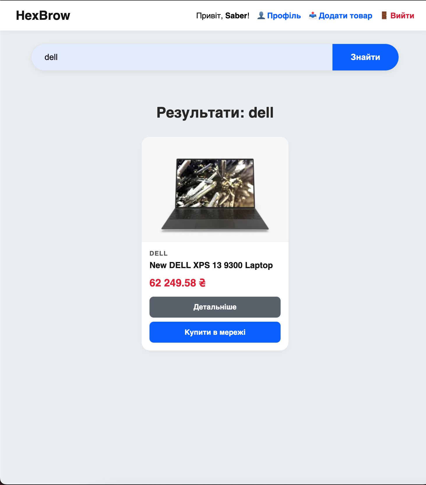
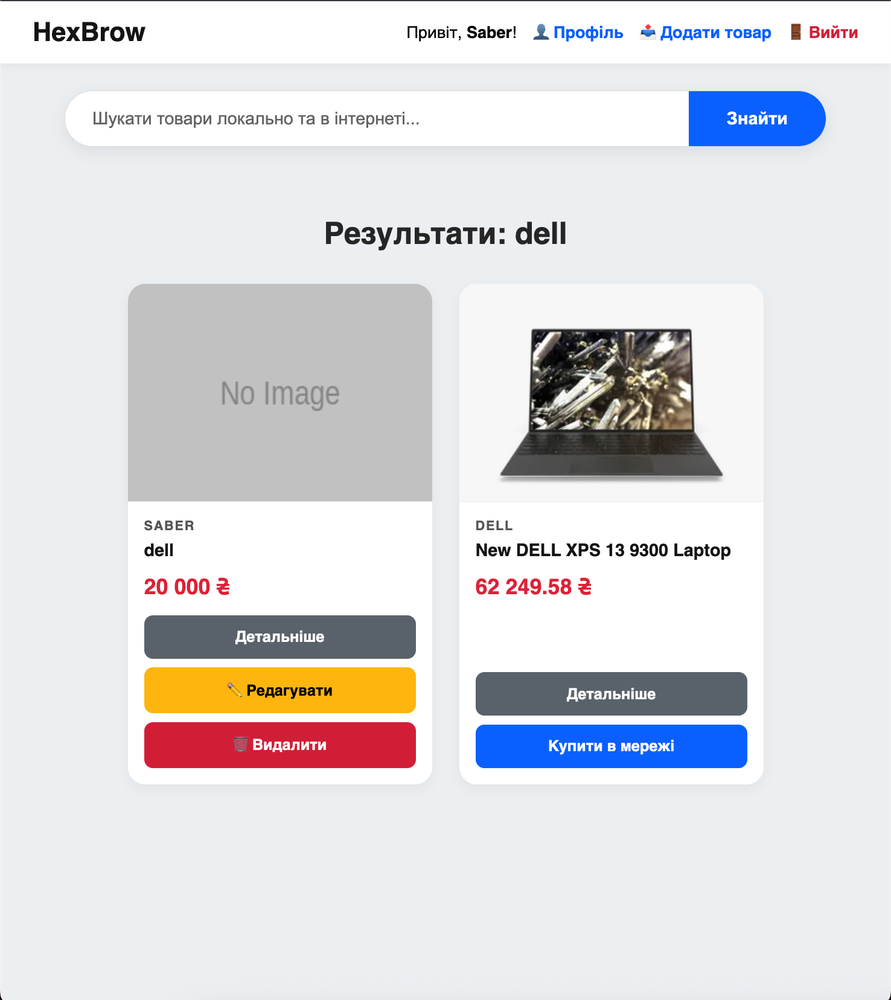
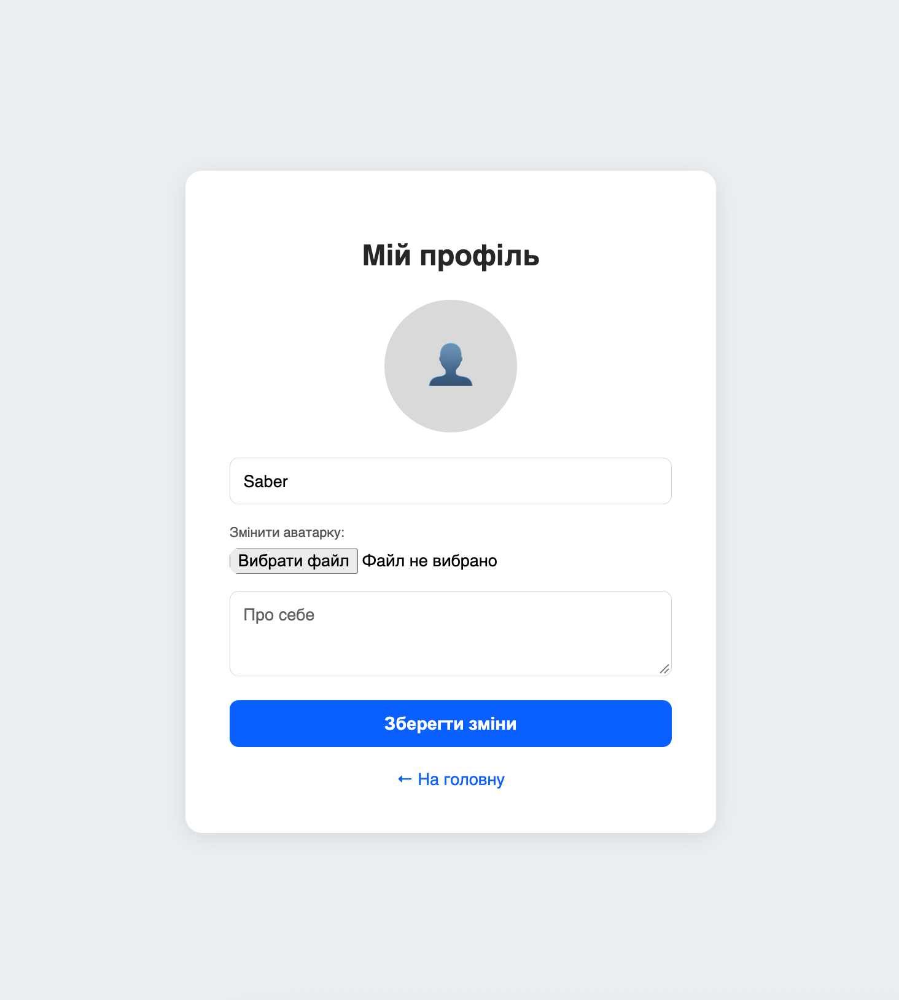
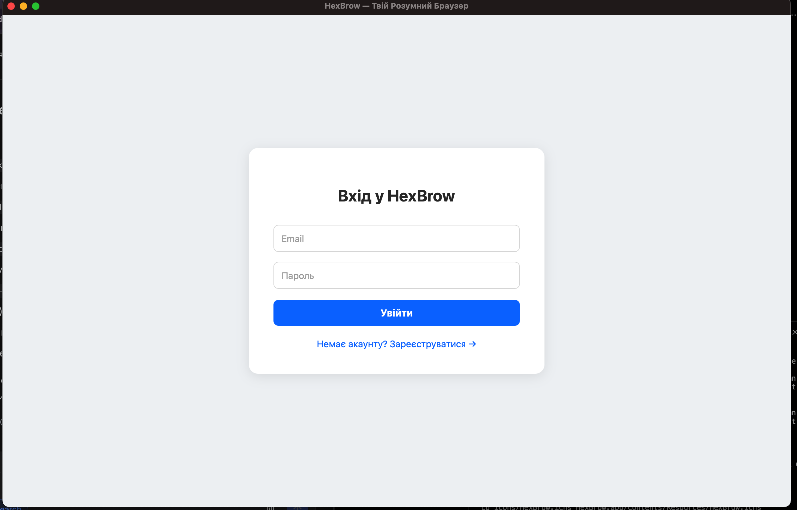
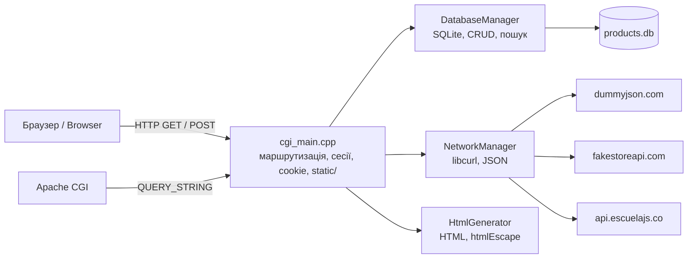
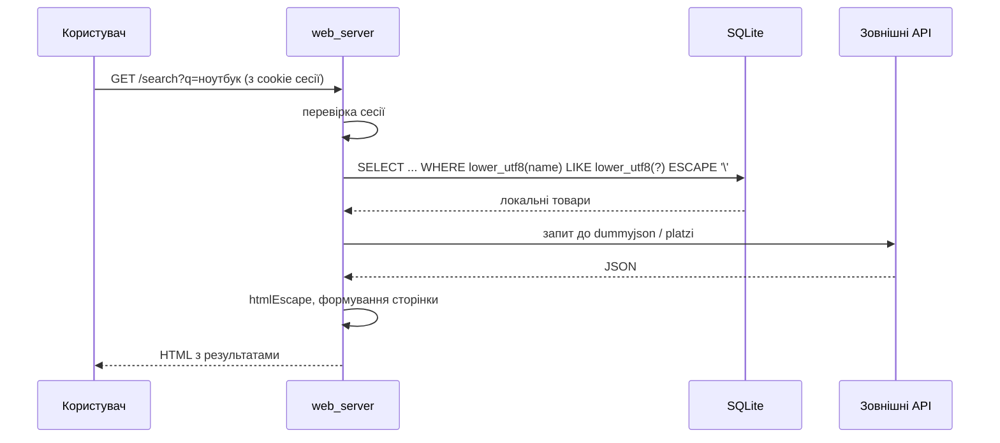
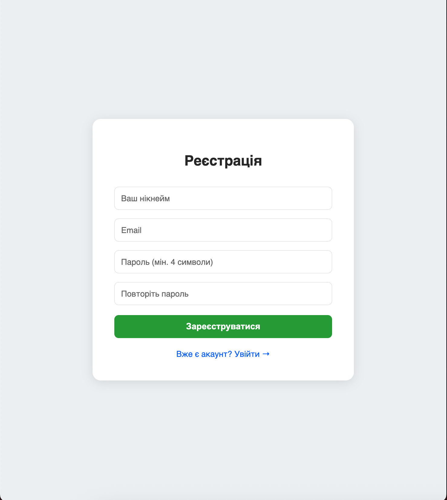

<div align="center">


# HexBrow

**Web-орієнтована пошукова система товарів на C++ / Web-oriented product search engine in C++**

[](https://isocpp.org/)
[](https://www.sqlite.org/)
[](#вимоги)
[](#тестування)
[](#автор-і-ліцензія)

**Мова / Language:** [Українська](#українська) · [English](#english)

</div>

---

<a id="українська"></a>

# 🇺🇦 Українська

## Зміст

1. [Про проєкт](#про-проєкт)
2. [Демонстрація](#демонстрація)
3. [Можливості](#можливості)
4. [Швидкий старт](#швидкий-старт)
5. [Архітектура](#архітектура)
6. [Структура проєкту](#структура-проєкту)
7. [Вимоги](#вимоги)
8. [Цілі Makefile](#цілі-makefile)
9. [Запуск](#запуск)
10. [База даних і міграції](#база-даних-і-міграції)
11. [Безпека](#безпека)
12. [Зовнішні API](#зовнішні-api)
13. [Тестування](#тестування)
14. [Відомі обмеження](#відомі-обмеження)
15. [Відхилення від методичних рекомендацій](#відхилення-від-методичних-рекомендацій)
16. [Додавання зображень до README](#додавання-зображень-до-readme)
17. [Автор і ліцензія](#автор-і-ліцензія)

---

## Про проєкт

HexBrow — курсова робота з дисципліни «Програмування» (спеціальність 123 «Комп'ютерна інженерія», НТУ «Дніпровська політехніка», варіант 5: *Web-орієнтована пошукова система*).

Програма шукає товари в локальній базі SQLite і в трьох відкритих API та повертає динамічну HTML-сторінку. Бекенд написано на C++17 без зовнішніх фреймворків. HTTP-запити виконує libcurl, JSON розбирає nlohmann/json.

Є два режими роботи з одним кодом:

- **CGI-режим.** Основна вимога варіанту 5. Apache запускає `web_server` як CGI-скрипт.
- **Вбудований сервер.** `web_server --serve <порт>` слухає сокет на `127.0.0.1`. Це доповнення, яке не потребує Apache.

Окремо є нативний застосунок для macOS (`HexBrow.app`) з іконкою, який працює на тому самому сервері.

## Демонстрація

> Знімки екрана зберігаються в `docs/`. Інструкція з додавання зображень — в [кінці розділу](#додавання-зображень-до-readme).

<table>
  <tr>
    <td align="center" width="50%">
      <br>
      <sub><b>Вхід</b> — сесія в cookie HttpOnly</sub>
    </td>
    <td align="center" width="50%">
      <br>
      <sub><b>Пошук у локальній базі</b></sub>
    </td>
  </tr>
  <tr>
    <td align="center" width="50%">
      <br>
      <sub><b>Пошук у зовнішніх API</b></sub>
    </td>
    <td align="center" width="50%">
      <br>
      <sub><b>Каталог товарів (CRUD)</b></sub>
    </td>
  </tr>
  <tr>
    <td align="center" width="50%">
      <br>
      <sub><b>Профіль користувача</b></sub>
    </td>
    <td align="center" width="50%">
      <br>
      <sub><b>Нативний застосунок для macOS</b></sub>
    </td>
  </tr>
</table>

## Можливості

**Пошук**
- Пошук у локальній базі й у зовнішніх API на одній сторінці результатів.
- Регістр не має значення, включно з кирилицею: `НОУТБУК` знаходить `ноутбук`.
- Символи `%` і `_` у запиті шукаються буквально.
- Порядок параметрів в URL не важливий: `/search?x=1&q=dell` працює.

**Товари**
- Створення, перегляд, редагування, видалення товарів (CRUD).
- Фото товару завантажується як base64.

**Облікові записи**
- Реєстрація, вхід, вихід. Сесія зберігається в cookie `HttpOnly` з `SameSite=Strict`.
- Вихід видаляє сесію на сервері, старий cookie більше не працює.
- Профіль: нікнейм, аватар, опис.

**Дані**
- Старі бази оновлюються через `ALTER TABLE`. Колонки додаються, дані зберігаються.
- Шлях до бази й каталогу `static/` визначається від розташування `web_server`, а не від поточної директорії.

## Швидкий старт

```bash
make web      # збирає сервер і лаунчер, запускає сервер і відкриває браузер
make mac      # (macOS) збирає HexBrow.app з іконкою і запускає його
make stop     # зупиняє сервер
make info     # показує, чи працює сервер
```

Після `make web` відкриється `http://127.0.0.1:8080/login`.

## Архітектура



Послідовність пошуку / Search sequence:



Модулі `DatabaseManager`, `NetworkManager` і `HtmlGenerator` не залежать від інтерфейсу. Їх використовують і CGI, і вбудований сервер.

## Структура проєкту

```text
HexBrow/
├── src/
│   ├── cgi_main.cpp            # Точка входу: CGI і вбудований сервер (--serve)
│   ├── DatabaseManager.h/.cpp  # SQLite: CRUD, пошук, облікові записи, міграції
│   ├── NetworkManager.h/.cpp   # Запити до зовнішніх API і розбір JSON
│   ├── HtmlGenerator.h/.cpp    # Генерація HTML, екранування
│   ├── Product.h, User.h       # Структури даних
│   ├── Favicon.h               # Генерується tools/make_favicon_header.py
│   ├── json.hpp                # nlohmann/json (сторонній, MIT)
│   └── resurces/index.html     # Форма пошуку для режиму Apache
├── main.cpp                    # Лаунчер HexBrowWeb: запускає сервер і браузер
├── browser.mm                  # Нативний GUI для macOS (Cocoa + WebKit)
├── macos/Info.plist            # Шаблон Info.plist для .app
├── icons/                      # HexBrow.icns (macOS), HexBrow.ico (Windows), PNG
├── tools/make_favicon_header.py
├── docs/
│   ├── images/                 # Іконка для README
│   └── screenshots/            # Знімки екрана для README
├── Makefile
├── .gitignore
└── README.md
```

Під час роботи створюються (в git не зберігаються): `products.db`, `static/`, `web_server`, `HexBrowWeb`, `HexBrowApp`, `HexBrow.app/`.

## Вимоги

- Компілятор C++17: `clang++` або `g++`. На Linux: `make web CXX=g++`.
- Бібліотеки SQLite3 і libcurl. На macOS входять до SDK.
- Для `make mac`: macOS 10.15+ і Xcode Command Line Tools.
- Для CGI-режиму: Apache з `mod_cgi`.
- Windows: `Makefile` написано для Unix-середовища. Збірка на Windows не перевірялася.

## Цілі Makefile

| Ціль | Що робить |
| --- | --- |
| `make web` | Збирає `web_server` і `HexBrowWeb`, запускає сервер і відкриває браузер |
| `make mac` | Збирає `HexBrow.app` (GUI, сервер, іконка) і відкриває його |
| `make bundle` | Лише збирає `.app`, не запускаючи |
| `make restart` | Перезапускає сервер без відкриття браузера |
| `make stop` | Зупиняє `web_server` |
| `make info` | Показує, чи працює сервер, і список команд |
| `make db-clean` | Видаляє `products.db` (усі дані) |
| `make favicon` | Перегенеровує `src/Favicon.h` |
| `make clean` | Видаляє зібрані файли і `HexBrow.app` |

## Запуск

### Варіант 1. `make web` (рекомендовано)

```bash
make web
```

Лаунчер зупиняє старий сервер, запускає новий на порту 8080 і відкриває браузер. Сервер слухає лише `127.0.0.1`.

### Варіант 2. Нативний застосунок для macOS

```bash
make mac
```

Збирається `HexBrow.app` з іконкою. Застосунок запускає `web_server` зі свого бандлу. Якщо `.app` переміщено, а `web_server` не знайдено, з'явиться повідомлення про помилку.

### Варіант 3. Apache (CGI)

1. Увімкніть `mod_cgi` і налаштуйте каталог:

   ```apache
   <Directory "/path/to/htdocs/cgi-bin">
       Options +ExecCGI
       AddHandler cgi-script .cgi
       Require all granted
   </Directory>
   ```

2. Скопіюйте `web_server` у `cgi-bin/search.cgi` і виконайте `chmod +x`.
3. Скопіюйте `src/resurces/index.html` у `htdocs` і відкривайте сторінку з кореня сервера.
4. `products.db` створюється поруч із `web_server`. Веб-сервер має мати право запису в цей каталог.

## База даних і міграції

- Таблиці `products` і `users` створюються, якщо їх немає.
- Для старих баз виконується міграція: відсутні колонки додаються через `ALTER TABLE`. Таблиці не видаляються, дані зберігаються.
- Email має унікальний індекс `idx_users_email`. Старі записи без email його не порушують.
- Розташування бази: поруч із `web_server`. Для `make web` це корінь репозиторію, для `make mac` — `HexBrow.app/Contents/MacOS/`.

Щоб почати з порожньої бази, виконайте `make db-clean`.

## Безпека

**Реалізовано:**
- Параметризовані SQL-запити (захист від SQL-ін'єкцій).
- `htmlEscape` для тексту, атрибутів і `<title>`. Рядки в JavaScript екрануються через `escapeJs`.
- Захист від path traversal для `/static/`: перевірка канонічного шляху за компонентами, а не за рядковим префіксом. Симлінки назовні блокуються.
- Токен сесії: 32 hex-символи з `/dev/urandom` (на Windows — `rand_s`). Cookie `HttpOnly` і `SameSite=Strict`.
- `SIGPIPE` ігнорується на Unix, тому закриття з'єднання клієнтом не зупиняє сервер.
- `LIKE` з `ESCAPE '\'`: `%` і `_` не працюють як wildcard.

**Обмеження (навчальний проєкт):**
- Паролі хешуються через `std::hash`. Це не криптографічний хеш, і його результат залежить від стандартної бібліотеки. Для реальної роботи потрібні bcrypt, scrypt або Argon2.
- Сесії зберігаються в пам'яті без терміну дії.
- Немає CSRF-токенів.
- Немає обмеження частоти запитів до `/login`.
- Немає HTTPS.

## Зовнішні API

| Джерело | Що повертає | Коли використовується |
| --- | --- | --- |
| [dummyjson.com](https://dummyjson.com) | до 100 товарів, пошук за запитом | завжди, коли є запит |
| [fakestoreapi.com](https://fakestoreapi.com) | 20 товарів | лише при порожньому запиті |
| [api.escuelajs.co](https://api.escuelajs.co) (Platzi) | до 100 товарів, пошук за назвою | завжди, коли є запит |

Ціни з dummyjson і fakestoreapi в USD і переводяться в гривні за курсом 41.5. Курс фіксований і орієнтовний.

## Тестування

Сервер зібрано на Linux з `g++ -std=c++17 -Wall -Wextra` без попереджень.

| Перевірка | Очікуваний результат | Статус |
| --- | --- | --- |
| `GET /static/../../file` | 403 | ✅ |
| `GET /static/../products.db` | 403 | ✅ |
| Симлінк з `static/` назовні | 403 | ✅ |
| Пошук `ноутбук`, `НОУТБУК`, `ЇЖАК` | знаходить незалежно від регістру | ✅ |
| `%` і `_` у запиті | літерали, не wildcard | ✅ |
| `<script>` у запиті і в назві товару | екрановано | ✅ |
| Токени сесій при трьох входах | різні, 32 hex-символи | ✅ |
| Вихід і повторне використання cookie | перенаправлення на `/login` | ✅ |
| Міграція старої бази без `email` | дані збережено, колонки додано | ✅ |
| Запуск з іншої директорії | база і `static/` поруч з `web_server` | ✅ |
| Розрив з'єднання під час великої відповіді | сервер працює далі | ✅ |
| Сторінка входу відкривається в браузері | `/login` показує форму | ✅ (знімок) |
| `make web_server` без попереджень | так | ✅ |
| Збірка й запуск `browser.mm` на macOS | — | ⏳ перевірити на Mac |
| `make web` на macOS | — | ⏳ перевірити на Mac |
| Збірка на Windows | — | ⏳ не перевірялося |

**Як відтворити тести.** Запустіть `make web`, потім виконайте запити з таблиці. Наприклад:

```bash
curl -s --path-as-is -o /dev/null -w "%{http_code}\n" "http://127.0.0.1:8080/static/../products.db"   # очікуємо 403
```

## Відомі обмеження

- **Паролі** — `std::hash` (див. [Безпека](#безпека)).
- **Сесії** не мають терміну дії, поки працює сервер.
- **Немає CSRF-токенів.** Частково захищає `SameSite=Strict`.
- **Немає rate limiting** на `/login`.
- **Вбудований сервер однопотоковий.**
- **Ім'я користувача унікальне**, успадковано зі старої схеми.
- **Старі користувачі без email** не можуть увійти, потрібна повторна реєстрація.
- **GUI** збирається тільки на macOS і не перевірений на Windows.
- **Курс валюти** фіксований.

## Відхилення від методичних рекомендацій

Погоджено з викладачем за умови, що відхилення описані в звіті та у файлах проєкту, а базовий функціонал виконано.

| Методичка | Реалізація | Причина |
| --- | --- | --- |
| Apache як веб-сервер (рекомендація) | Вбудований сервер `--serve`, CGI збережено | Apache потребує окремого налаштування на кожній ОС |
| Пошук лише в базі даних | Пошук у базі і в зовнішніх API | Розширення функціоналу, пошук у базі збережено |
| Консольна програма або GUI на MFC/FLTK | Веб-інтерфейс і нативний застосунок для macOS | Варіант 5 вимагає веб-інтерфейс, GUI — доповнення |

## Додавання зображень до README

### 1. Структура

```text
docs/
├── images/        # іконка, логотип (маленькі PNG)
└── screenshots/   # знімки екрана для розділу «Демонстрація»
    ├── 01-login.png
    ├── 02-register.png
    ├── 03-search-local.png
    ├── 04-search-internet.png
    ├── 05-catalog.png
    ├── 06-product-add.png
    ├── 07-product-edit.png
    ├── 08-profile.png
    ├── 09-mac-app.png
    ├── 10-mac-dock-icon.png
    ├── 11-favicon-tab.png
    ├── 12-security-403.png
    ├── 13-make-web.png
    └── demo.gif
```

Правила імен: лише латиниця, цифри і дефіси, без пробілів. Номер на початку задає порядок.

### 2. Як зробити знімки на Mac

- **Вікно з тінню:** `⌘ Shift 4`, потім `Space`, потім клік по вікну. Тінь вікна збережеться.
- **Частина екрана:** `⌘ Shift 4`, потім виділіть область.
- **Термінал:** `⌘ Shift 4`, `Space`, клік по вікну Terminal.

### 3. Як стиснути і зменшити зображення

```bash
# Максимальний розмір 1600 px по довшій стороні (вбудований у macOS інструмент sips)
sips -Z 1600 docs/01-login.png

# Стиснення PNG (потрібен pngquant: brew install pngquant)
pngquant --quality=70-90 --force --output docs/01-login.png docs/01-login.png
```

Бажано, щоб кожен файл був до 500 КБ.

### 4. Як вставити зображення в README

Вставка в один рядок:

```markdown

```

Для сітки з кількох зображень використовуйте `<table>`, як у розділі «Демонстрація». Для великої кількості знімків зручно згорнути їх у `<details>`:

```html
<details>
  <summary><b>Усі знімки (12)</b></summary>

  
  
  <!-- ще зображення -->
</details>
```

### 5. Як зробити GIF з демонстрацією

На Mac запишіть екран через `⌘ Shift 5`, збережіть `.mov`, потім:

```bash
# brew install ffmpeg
ffmpeg -i demo.mov -vf "fps=10,scale=960:-1:flags=lanczos" -loop 0 docs/demo.gif
```

GIF до 5–8 МБ добре працює на GitHub. Довші записи краще залишити як посилання на відео.

### 6. Діаграми без зображень

Для схем використовуйте Mermaid, як у розділі «Архітектура». GitHub відображає такі діаграми автоматично, без файлів PNG.

### 7. Перевірка перед комітом

```bash
# знайти посилання на зображення, яких немає
grep -o 'docs/[^")]*' README.md | sort -u | while read f; do [ -f "$f" ] || echo "MISSING: $f"; done
```

Якщо виводу немає, усі зображення на місці.

## Автор і ліцензія

**Автор:** Ілля Лебідь (GitHub: [SaberWQ](https://github.com/SaberWQ)), студент 1 курсу, спеціальність «Комп'ютерна інженерія», НТУ «Дніпровська політехніка».

**Керівник:** доцент кафедри інформаційних технологій та комп'ютерної інженерії, к.т.н. І. М. Гаркуша.

**Ліцензія:** навчальний проєкт, ліцензія не вказана.

---

<div align="right"><a href="#hexbrow">↑ угору / back to top</a></div>

<br>

<a id="english"></a>

# 🇬🇧 English

## Contents

1. [About](#about)
2. [Screenshots](#screenshots)
3. [Features](#features)
4. [Quick start](#quick-start)
5. [Architecture](#architecture)
6. [Project layout](#project-layout)
7. [Requirements](#requirements)
8. [Make targets](#make-targets)
9. [Running](#running)
10. [Database and migrations](#database-and-migrations)
11. [Security](#security)
12. [External APIs](#external-apis)
13. [Testing](#testing)
14. [Known limitations](#known-limitations)
15. [Deviations from the course guidelines](#deviations-from-the-course-guidelines)
16. [Adding images to this README](#adding-images-to-this-readme)
17. [Author and license](#author-and-license)

---

## About

HexBrow is a coursework project for the "Programming" course (specialty 123 Computer Engineering, National Technical University "Dnipro Polytechnic", variant 5: *Web-oriented product search engine*).

The program searches products in a local SQLite database and in three public APIs, and returns a dynamically generated HTML page. The backend is C++17 without external frameworks. HTTP requests use libcurl; JSON is parsed with nlohmann/json.

Two modes share the same code:

- **CGI mode.** The main requirement of variant 5. Apache runs `web_server` as a CGI script.
- **Built-in server.** `web_server --serve <port>` listens on `127.0.0.1`. This is an addition that does not require Apache.

There is also a native macOS app (`HexBrow.app`) with an icon, which uses the same server.

## Screenshots

> Screenshots live in `docs/`. See [Adding images](#adding-images-to-this-readme) at the end.

The screenshots above are shown in the Ukrainian section. Each one is captioned there.

## Features

**Search**
- Search in the local database and external APIs on one results page.
- Case-insensitive, including Cyrillic: `НОУТБУК` finds `ноутбук`.
- `%` and `_` in the query are matched literally.
- Parameter order in the URL does not matter: `/search?x=1&q=dell` works.

**Products**
- Create, read, update and delete products (CRUD).
- Product photos uploaded as base64.

**Accounts**
- Registration, login, logout. The session is stored in an `HttpOnly` cookie with `SameSite=Strict`.
- Logout deletes the session on the server, so the old cookie stops working.
- Profile: nickname, avatar, description.

**Data**
- Old databases are upgraded with `ALTER TABLE`. Columns are added, data is kept.
- The database and `static/` are located relative to `web_server`, not the current directory.

## Quick start

```bash
make web      # builds the server and launcher, starts the server, opens the browser
make mac      # (macOS) builds HexBrow.app with icon and runs it
make stop     # stops the server
make info     # shows whether the server is running
```

After `make web`, open `http://127.0.0.1:8080/login`.

## Architecture

See the diagrams in the Ukrainian section above (Mermaid). They are the same for both languages.

## Project layout

See [Структура проєкту](#структура-проєкту). File names are the same.

## Requirements

- A C++17 compiler: `clang++` or `g++`. On Linux: `make web CXX=g++`.
- SQLite3 and libcurl. Both are included in the macOS SDK.
- For `make mac`: macOS 10.15+ and Xcode Command Line Tools.
- For CGI mode: Apache with `mod_cgi`.
- Windows: the `Makefile` targets a Unix-like environment. A Windows build has not been verified.

## Make targets

| Target | Purpose |
| --- | --- |
| `make web` | Builds `web_server` and `HexBrowWeb`, starts the server and opens the browser |
| `make mac` | Builds `HexBrow.app` (GUI, server, icon) and opens it |
| `make bundle` | Builds the `.app` without launching it |
| `make restart` | Restarts the server without opening the browser |
| `make stop` | Stops `web_server` |
| `make info` | Shows whether the server is running and lists commands |
| `make db-clean` | Deletes `products.db` (all data) |
| `make favicon` | Regenerates `src/Favicon.h` |
| `make clean` | Removes build output and `HexBrow.app` |

## Running

### Option 1. `make web` (recommended)

```bash
make web
```

The launcher stops the old server, starts a new one on port 8080, and opens the browser. The server listens on `127.0.0.1` only.

### Option 2. Native macOS app

```bash
make mac
```

Builds `HexBrow.app` with an icon. The app starts `web_server` from its own bundle. If the `.app` has been moved and `web_server` is not found, an error dialog appears.

### Option 3. Apache (CGI)

1. Enable `mod_cgi` and configure the directory:

   ```apache
   <Directory "/path/to/htdocs/cgi-bin">
       Options +ExecCGI
       AddHandler cgi-script .cgi
       Require all granted
   </Directory>
   ```

2. Copy `web_server` to `cgi-bin/search.cgi` and run `chmod +x`.
3. Copy `src/resurces/index.html` to `htdocs` and open the page from the server root.
4. `products.db` is created next to `web_server`. The web server user must be able to write there.

## Database and migrations

- The `products` and `users` tables are created if they do not exist.
- Old databases are migrated: missing columns are added with `ALTER TABLE`. Tables are never dropped, data is kept.
- Email has a unique index `idx_users_email`. Old rows without email do not violate it.
- Location: next to `web_server`. For `make web` that is the repository root; for `make mac` it is `HexBrow.app/Contents/MacOS/`.

To start with an empty database, run `make db-clean`.

## Security

**Implemented:**
- Parameterized SQL queries (no SQL injection).
- `htmlEscape` for text, attributes and `<title>`. Strings embedded in JavaScript are escaped with `escapeJs`.
- Path traversal protection for `/static/`: the canonical path is checked by path components, not by string prefix. Symlinks pointing outside are rejected.
- Session token: 32 hex characters from `/dev/urandom` (`rand_s` on Windows). Cookie is `HttpOnly` and `SameSite=Strict`.
- `SIGPIPE` is ignored on Unix, so a client closing a connection does not stop the server.
- `LIKE` with `ESCAPE '\'`: `%` and `_` do not act as wildcards.

**Limitations (educational project):**
- Passwords are hashed with `std::hash`. It is not cryptographic, and its output depends on the standard library. Real use requires bcrypt, scrypt or Argon2.
- Sessions live in memory and have no expiry.
- No CSRF tokens.
- No rate limiting on `/login`.
- No HTTPS.

## External APIs

| Source | Returns | When used |
| --- | --- | --- |
| [dummyjson.com](https://dummyjson.com) | up to 100 products, search by query | whenever there is a query |
| [fakestoreapi.com](https://fakestoreapi.com) | 20 products | only for an empty query |
| [api.escuelajs.co](https://api.escuelajs.co) (Platzi) | up to 100 products, search by title | whenever there is a query |

Prices from dummyjson and fakestoreapi are in USD and converted to UAH at 41.5. The rate is fixed and approximate.

## Testing

The server was built on Linux with `g++ -std=c++17 -Wall -Wextra` with no warnings.

| Check | Expected | Status |
| --- | --- | --- |
| `GET /static/../../file` | 403 | ✅ |
| `GET /static/../products.db` | 403 | ✅ |
| Symlink from `static/` to outside | 403 | ✅ |
| Search `ноутбук`, `НОУТБУК`, `ЇЖАК` | found regardless of case | ✅ |
| `%` and `_` in the query | literal characters | ✅ |
| `<script>` in query and product name | escaped | ✅ |
| Session tokens after three logins | different, 32 hex characters | ✅ |
| Logout and reuse of the cookie | redirect to `/login` | ✅ |
| Migration of an old database without `email` | data kept, columns added | ✅ |
| Start from another directory | database and `static/` next to `web_server` | ✅ |
| Client disconnect during a large response | server keeps running | ✅ |
| Login page loads in a browser | form is shown | ✅ (screenshot) |
| `browser.mm` build and run on macOS | — | ⏳ to verify on Mac |
| `make web` on macOS | — | ⏳ to verify on Mac |
| Windows build | — | ⏳ not verified |

## Known limitations

- **Passwords:** `std::hash` (see [Security](#security)).
- **Sessions** have no expiry while the server runs.
- **No CSRF tokens.** Partly mitigated by `SameSite=Strict`.
- **No rate limiting** on `/login`.
- **The built-in server is single-threaded.**
- **Usernames are unique**, inherited from the old schema.
- **Old users without email** cannot log in and must register again.
- **The GUI** builds only on macOS and has not been verified on Windows.
- **The exchange rate** is fixed.

## Deviations from the course guidelines

Agreed with the supervisor, provided the deviations are described in the report and in the project files, and the basic functionality is delivered.

| Guideline | Implementation | Reason |
| --- | --- | --- |
| Apache as the web server (recommended) | Built-in `--serve` server; CGI mode kept | Apache requires separate setup on each OS |
| Search only in the database | Search in the database and external APIs | Extended functionality; database search kept |
| Console program or MFC/FLTK GUI | Web interface and a native macOS app | Variant 5 requires a web interface; GUI is an addition |

## Adding images to this README

### 1. Layout

```text
docs/
├── images/        # icon and logo (small PNG)
└── screenshots/   # screenshots for the Demo section
    ├── 01-login.png
    ├── 02-register.png
    ├── 03-search-local.png
    ├── 04-search-internet.png
    ├── 05-catalog.png
    ├── 06-product-add.png
    ├── 07-product-edit.png
    ├── 08-profile.png
    ├── 09-mac-app.png
    ├── 10-mac-dock-icon.png
    ├── 11-favicon-tab.png
    ├── 12-security-403.png
    ├── 13-make-web.png
    └── demo.gif
```

Naming rules: Latin letters, digits and hyphens only, no spaces. The number prefix sets the order.

### 2. Taking screenshots on macOS

- **Window with shadow:** `⌘ Shift 4`, then `Space`, then click the window.
- **Part of the screen:** `⌘ Shift 4`, then select an area.
- **Terminal output:** `⌘ Shift 4`, `Space`, then click the Terminal window.

### 3. Resizing and compressing

```bash
# limit the longest side to 1600 px (sips is built into macOS)
sips -Z 1600 docs/01-login.png

# compress PNG (needs pngquant: brew install pngquant)
pngquant --quality=70-90 --force --output docs/01-login.png docs/01-login.png
```

Keep each file under about 500 KB.

### 4. Embedding images

Single image:

```markdown

```

For a grid, use `<table>` as in the Demo section. For many screenshots, collapse them into `<details>`:

```html
<details>
  <summary><b>All screenshots (12)</b></summary>

  
  
  <!-- more images -->
</details>
```

### 5. Recording a GIF

On Mac, record the screen with `⌘ Shift 5`, save the `.mov`, then:

```bash
# brew install ffmpeg
ffmpeg -i demo.mov -vf "fps=10,scale=960:-1:flags=lanczos" -loop 0 docs/demo.gif
```

A GIF up to 5–8 MB works well on GitHub. For longer recordings, link to a video instead.

### 6. Diagrams without images

Use Mermaid for diagrams, as in the Architecture section. GitHub renders them without any PNG files.

### 7. Check before committing

```bash
# find image links whose files do not exist
grep -o 'docs/[^")]*' README.md | sort -u | while read f; do [ -f "$f" ] || echo "MISSING: $f"; done
```

No output means every image is in place.

## Author and license

**Author:** Illia Lebid (GitHub: [SaberWQ](https://github.com/SaberWQ)), first-year student, specialty 123 Computer Engineering, National Technical University "Dnipro Polytechnic".

**Supervisor:** Associate Professor, Department of Information Technologies and Computer Engineering, I. M. Harkusha, PhD.

**License:** academic project, no license specified.

---

<div align="right"><a href="#hexbrow">↑ back to top / угору</a></div>
